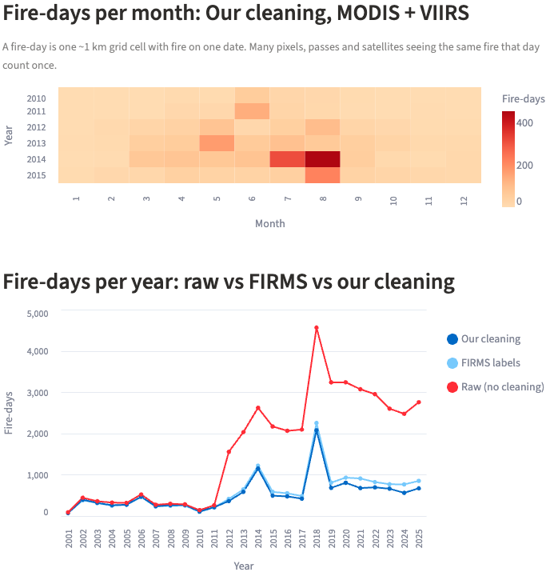

# Fire or Factory?

**Live app:** https://fireorfactory.streamlit.app/

A cleaned satellite fire record for Sweden. It merges 25 years of NASA MODIS and VIIRS hotspot detections into one validated dataset, and separates real vegetation fires from industrial heat sources such as steelworks, smelters, refineries and cement plants.

Built during the NASA Space Apps Challenge 2026 weekend (14–15 Nov) for the challenge _Harmonization of MODIS and VIIRS Hot Spots_, as a personal project (not an official submission).

<table>
  <tr>
    <td align="center" width="50%">
       
      <i>2018 hotspots over Sweden after cleaning. Orange: fire. Blue: factory or other static heat source.</i>
    </td>
    <td align="center" width="50%">
       
      <i>Fire-days per year, 2001–2025. From 2012, raw hotspot data is several times the cleaned fire record.</i>
    </td>
  </tr>
</table>

## Key findings

- **Most of what satellites "see burning" in Sweden is industry.** From 2012 to 2025, raw hotspot data gives 37,433 fire-days. After cleaning, 10,310 remain: **72% were static heat sources**, not fires.
- **In a normal year it is about 80%.** Only in the big fire years, 2014 and 2018, do real fires make up a larger share.
- **Raw data suggests Sweden burns all winter. It doesn't.** In November–February, 89% of VIIRS fire-days are industrial. In January 2018, 44 raw fire-days become 2.
- **NASA's own static-source labels miss some large industrial sites.** Steelworks, a refinery and a cement plant are labelled as vegetation fires hundreds of times over the years. Recurrence over 25 years catches them.
- **MODIS and VIIRS see Sweden very differently.** VIIRS's 375 m pixels detect factories on hundreds of days a year; MODIS's 1 km pixels see the same sites on only a handful. A record built from MODIS alone (2000–2011) is not comparable with one that includes VIIRS.

## The question

Of every hotspot a satellite saw over Sweden, which were real fires, and when and where does Sweden actually burn?

## Data

- **NASA FIRMS archive (standard processing)**, downloaded through the FIRMS area API for a box around Sweden:

  | Source                 | Pixel size | From     | Detections in Sweden |
  | ---------------------- | ---------- | -------- | -------------------- |
  | MODIS (Terra and Aqua) | ~1 km      | Nov 2000 | 8,214                |
  | VIIRS S-NPP            | ~375 m     | Jan 2012 | 79,053 (both VIIRS)  |
  | VIIRS NOAA-20          | ~375 m     | Apr 2018 |                      |

- **Natural Earth 1:10m country borders**, used to clip the box to Sweden. The border is extended 2 km out to sea, because coastal steelworks often show up as pixels just offshore, but never into Norway, Finland or Denmark.
- Period: 2001–2025, complete years only.

## Method

The pipeline is a command-line tool, `fof`, with one command per step.

1. **Ingest:** download raw CSVs, one per source and 5-day chunk (the API's limit).
2. **Normalise:** one schema for both sensors (renamed brightness columns, UTC timestamps, MODIS's 0–100 confidence mapped to VIIRS's low/nominal/high using FIRMS's thresholds), clipped to Sweden, duplicates removed, and validated with a [pandera](https://pandera.readthedocs.io) schema that stops the pipeline if the data breaks a rule.
3. **Features:** every detection is placed in a ~1 km grid cell. Each cell gets its **history**: active days, months, years, span, night share and typical fire power. Each cell also gets the history of the busiest cell in its 3×3 block, because detection positions wobble by about 600 m and a factory's pixels spill into neighbouring cells.
4. **Classify:** a LightGBM classifier gives each detection a probability of being static.
   - There is no ground truth, so FIRMS's own static labels (type 2 and 3) are used as noisy training labels, **from VIIRS only**. MODIS labels are much weaker.
   - Only history features are used. They mean the same for both sensors, whereas a MODIS pixel reports about 5× the fire power of a VIIRS pixel at the same factory.
   - Evaluation uses cross-validation grouped by grid cell, so the model is always scored on places it has never seen.
   - The model is then applied to MODIS too: a MODIS detection in a cell that VIIRS sees all year inherits that history. **This is the harmonisation step: VIIRS's sharper view corrects MODIS.**
5. **Fire calendar:** fire-days per year and month, in three versions (raw, FIRMS labels, our cleaning) and three sensor groups (MODIS, VIIRS, both). A **fire-day** is one 1 km cell with fire on one date, so many pixels, passes and satellites seeing the same fire on the same day count once.
6. **Export and app:** slim copies of the results for a Streamlit app with a map, the calendar and the disagreement list.

## Results

### Factories and fires look completely different over time

Median history of the grid cell a detection sits in, by FIRMS's label (all years):

|                              | FIRMS: fire | FIRMS: static |
| ---------------------------- | ----------- | ------------- |
| Active days                  | 2           | 2,491         |
| Active months (of 12)        | 1           | 12            |
| Active years                 | 1           | 23            |
| Share of detections at night | 52%         | 83%           |

A fire burns for days in one season. A factory is seen on thousands of days, every month, every year, mostly at night.

### How well the cleaning agrees with FIRMS

On VIIRS detections in grid cells the model never saw during training:

| Method                                    | Agreement with FIRMS |
| ----------------------------------------- | -------------------- |
| Simple rule: active in 6+ months = static | 95.0%                |
| LightGBM classifier                       | 96.5%                |

The simple rule does almost all the work. Recurrence is the signal - the model adds only a little.

### Where we disagree with FIRMS

Across all VIIRS detections, we call **2,400** static that FIRMS labels as fire, and **377** fire that FIRMS labels as static. The largest disagreements are all recurring sites. The coordinates match the locations of known industrial plants (check them yourself in the app, which links each one to satellite view):

| Location       | Detections FIRMS calls fire | Active days | Matches the location of     |
| -------------- | --------------------------- | ----------- | --------------------------- |
| 60.136, 16.189 | 433                         | 611         | Avesta steelworks           |
| 60.137, 15.416 | 221                         | 211         | Smedjebacken steelworks     |
| 58.360, 12.378 | 194                         | 1,799       | Vargön alloy smelter        |
| 60.489, 15.452 | 193                         | 674         | Borlänge steelworks         |
| 58.673, 17.134 | 154                         | 1,731       | Oxelösund steelworks        |
| 58.347, 11.424 | 147                         | 779         | Lysekil refinery            |
| 60.612, 16.794 | 102                         | 1,064       | Sandviken steelworks        |
| 57.710, 18.804 | 60                          | 2,016       | Slite cement plant, Gotland |

### Cleaned fire-days per year

| Year | Raw (VIIRS) | Cleaned (VIIRS) | Removed |
| ---- | ----------- | --------------- | ------- |
| 2014 | 2,309       | 855             | 63%     |
| 2017 | 1,954       | 310             | 84%     |
| 2018 | 4,201       | 1,737           | 59%     |
| 2021 | 2,953       | 577             | 80%     |
| 2025 | 2,632       | 563             | 79%     |

After cleaning, 2014 and 2018 stand out clearly as Sweden's big fire years. In raw data, 2019–2021 look almost as large as 2014, which they were not. In the consistent MODIS-only series (2001–2025), the five biggest years are 2018, 2014, 2006, 2002 and 2003.

## Limitations

- **There is no ground truth.** Agreement with FIRMS is not the same as being right, and FIRMS's labels are themselves the training data.
- **Site names are matched from coordinates**, not confirmed against a register of industrial plants.
- **About 390 MODIS detections that FIRMS calls static, we call fire.** They are scattered over 242 cells with a median of 2 active days, mostly daytime. With that little evidence they are genuinely ambiguous.
- **Combined sensor counts are not comparable across years.** VIIRS starts in 2012 and a second VIIRS satellite in 2018, and more satellites find more small fires. Use the MODIS-only series for long-term trends.
- **A fixed 1 km grid** can still split a source across cells; the 3×3 block reduces this but does not remove it. A radius-based neighbourhood would be the next improvement.
- **Cell fire power mixes sensors.** At sites seen only by MODIS (before 2012), the typical-power feature is on MODIS's higher scale.
- **No unit tests.** Data is validated by the pandera schema on every run.

## Quick start

    uv sync
    echo 'FIRMS_MAP_KEY="your-key"' > .env     # free key from FIRMS
    make app                                   # app runs on the committed data in app/data/

To rebuild everything from scratch (about an hour, mostly waiting for the FIRMS rate limit):

    uv run fof ingest --start 2000-11-01 --end 2025-12-31 --sources MODIS_SP
    uv run fof ingest --start 2012-01-20 --end 2025-12-31 --sources VIIRS_SNPP_SP
    uv run fof ingest --start 2018-04-01 --end 2025-12-31 --sources VIIRS_NOAA20_SP
    uv run fof normalise && uv run fof features && uv run fof classify && uv run fof calendar && uv run fof export

## Licence

MIT, see [LICENSE](LICENSE). NASA FIRMS data is open, see the sources for terms. Border data from Natural Earth (public domain).
