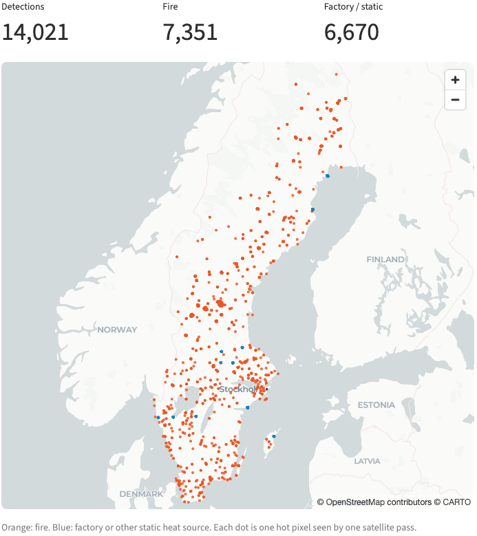

# Fire or Factory?

A cleaned satellite fire record for Sweden. It merges NASA MODIS and VIIRS hotspot detections into one validated dataset, and uses a classifier to separate real vegetation fires from industrial heat sources such as steelworks and pulp mills.

Built solo during the NASA Space Apps Challenge 2026 weekend (14-15 Nov) for the challenge _Harmonization of MODIS and VIIRS Hot Spots_, as a personal project (not an official submission).

## The question

Of every hotspot a satellite saw over Sweden, which were real fires, and when and where does Sweden actually burn?

<table>
  <tr>
    <td align="center" width="50%">
       
      <i>2018 hotspots over Sweden after cleaning. Orange: fire. Blue: factory or other static heat source.</i>
    </td>
    <td align="center" width="50%">
       
      <i>Fire-days per year, 2001–2025</i>
    </td>
  </tr>
</table>

## Planned output

- A reproducible Python pipeline that ingests MODIS and VIIRS detections for Sweden into one dataset.
- A classifier labelling each hotspot as vegetation fire or static/industrial heat, with a probability.
- A cleaned fire calendar (year x month), with the 2018 fire season as the showcase.
- A Streamlit map app with a public link.

## Quick start

    uv sync
    cp .env.example .env     # add your FIRMS_MAP_KEY
    make test
    make app

## Layout

    src/fof/      ingest, normalise, features, model, fire_calendar, cli
    app/          Streamlit app
    tests/
    data/         gitignored raw and clean data

## Data, method, results, limits

To be written at the end of the weekend.

## AI use

See [AI_USE.md](AI_USE.md). Sources are listed in [SOURCES.md](SOURCES.md).

## Licence

MIT, see [LICENSE](LICENSE). NASA FIRMS data is open; see the sources for terms.
